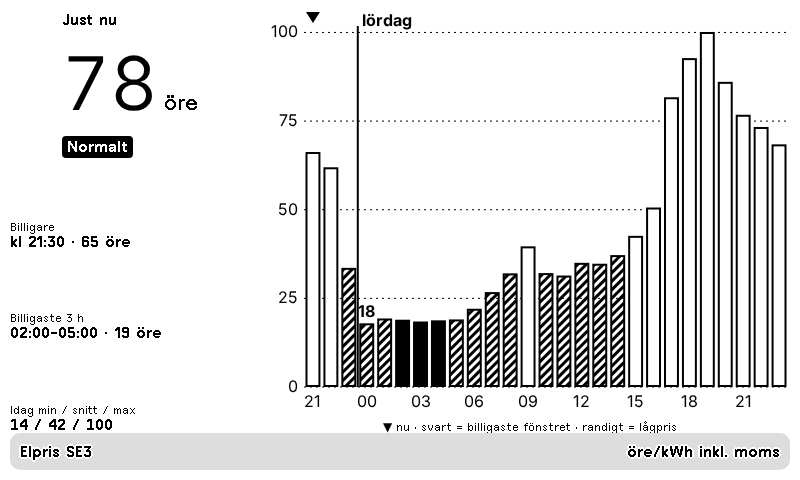

# Elpris – billigaste timmarna

Plugin för [TRMNL](https://trmnl.com) (e-pappersskärm). Spotpris på el för SE1–SE4 med priset just nu, när det blir billigare, det billigaste sammanhängande fönstret och ett stapeldiagram för i dag och i morgon.



Alla fyra layouter (full, half_horizontal, half_vertical, quadrant) finns, så den fungerar i mashups.
Se [`preview/overview.png`](preview/overview.png).

## Inställningar

- **Elområde** – SE1–SE4
- **Visa med moms** – av/på
- **Påslag** – öre/kWh som läggs på spotpriset före moms (energiskatt, nätavgift, elhandlarens påslag)
- **Billigaste fönster** – antal timmar som markeras

## Installera

**Import:** zippa innehållet i `src/` (platt, inga mappar) och välj TRMNL → Plugins → Private Plugin → **Import new**.

```sh
cd src && zip ../elpris.zip * && cd ..
```

**[trmnlp](https://github.com/usetrmnl/trmnlp):**

```sh
trmnlp login    # en gång
trmnlp push     # laddar upp src/; lägg sedan till id: i src/settings.yml
trmnlp serve    # förhandsvisning på http://localhost:4567 med värdena i .trmnlp.yml
```

## Om

Elpriser tillhandahålls av [Elpriset just nu.se](https://www.elprisetjustnu.se). En tredje polling-URL (Open-Meteo) fungerar bara som "tick": TRMNL ritar inte om skärmen när hämtad data är oförändrad, och prisfilerna är desamma hela dygnet.

## Licens

[MIT](LICENSE)
